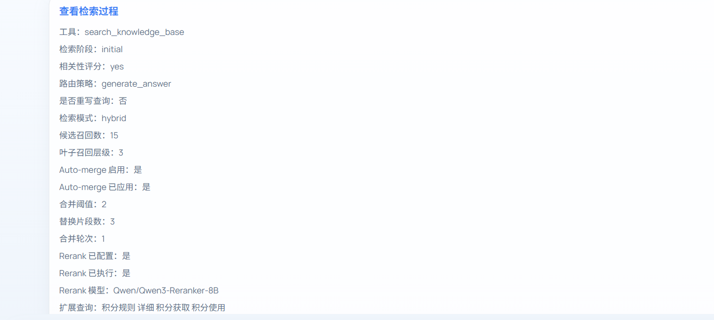

# SuperMew / SuperService RAG Agent

这是一个基于 FastAPI、LangChain、LangGraph 和 Milvus 开发的 AI 智能客服与 RAG 知识库项目。

项目实现了完整的用户端和管理员端：普通用户可以与 AI 流式聊天、查询知识库、转接人工客服；管理员可以管理知识库、商品、用户和客服会话。系统还集成了天气、物流、语音和图片理解等能力，适合用于学习 RAG、Agent、向量数据库和 AI 客服系统的完整开发流程。

## 项目效果

### 用户端

- 用户注册、登录和身份认证。
- 创建、查看和删除历史会话。
- 与 AI 进行 SSE 流式对话。
- 基于知识库回答商品、文档和业务问题。
- 查询天气和快递物流信息。
- 上传语音进行识别，将回答转换为语音。
- 主动申请转接人工客服。
- 通过 WebSocket 实时接收人工客服回复。

### 管理员端

- 查看用户列表并管理用户账号和角色。
- 查看所有客服会话及未读消息。
- 接管用户会话、回复消息和关闭会话。
- 上传、查看和删除知识库文档。
- 查看 RAG 检索过程和召回结果。
- 新增、编辑和删除商品资料及商品图片。
- 管理员与用户消息实时同步。

## RAG 知识库实现

系统支持上传以下文档：

- PDF
- Word：`.doc`、`.docx`
- Excel：`.xls`、`.xlsx`

文档入库后会经过以下流程：

1. 读取并清洗文档内容。
2. 使用滑动窗口生成 L1、L2、L3 多级文本块。
3. 将 L1、L2 父级文本块保存到 PostgreSQL。
4. 将 L3 叶子文本块转换为向量并写入 Milvus。
5. 提取 PDF 中的图片，并使用视觉模型生成图片描述。
6. 用户提问时同时进行向量检索和 BM25 关键词检索。
7. 使用 RRF 融合两路检索结果。
8. 根据配置进行 Rerank 精排、问题改写和父块自动合并。
9. 将召回内容交给大模型生成最终回答。

这种设计既保留了小文本块检索准确的优点，也可以通过父块补充更完整的上下文。

## Agent 工具能力

除了知识库问答，Agent 还可以根据用户问题自动选择工具：

- 知识库检索：回答上传文档中的内容。
- 商品查询：根据名称、分类、材质和规格查询商品。
- 天气查询：支持 Open-Meteo 和高德天气。
- 物流查询：支持快递鸟、阿里云物流和快递100。
- 转人工判断：识别用户的人工客服请求并切换会话状态。
- 语音服务：使用阿里云实现语音识别和语音合成。

## 技术栈

| 类型 | 技术 |
| --- | --- |
| 后端 | Python 3.12、FastAPI、SQLAlchemy、Pydantic |
| Agent | LangChain、LangGraph |
| 大模型 | OpenAI 兼容接口 |
| 向量检索 | Milvus |
| 关系数据库 | PostgreSQL |
| 缓存 | Redis |
| 对象存储 | MinIO |
| 前端 | Vue 3、JavaScript、CSS |
| 实时通信 | SSE、WebSocket |
| 本地环境 | uv、Docker Compose |

## 项目结构

```text
SuperMew/
├─ backend/
│  ├─ app.py                 FastAPI 应用入口
│  ├─ api.py                 HTTP、SSE 和 WebSocket 接口
│  ├─ agent.py               Agent 对话流程
│  ├─ rag_pipeline.py        RAG 检索与生成流程
│  ├─ rag_utils.py           混合检索、重排和父块合并
│  ├─ document_loader.py     文档解析与分块
│  ├─ embedding.py           Embedding 服务
│  ├─ milvus_client.py       Milvus 集合与检索操作
│  ├─ auth.py                JWT 鉴权与密码处理
│  ├─ customer_service.py    人工客服会话逻辑
│  ├─ product_service.py     商品管理逻辑
│  └─ tools.py               天气、物流等 Agent 工具
├─ frontend/
│  ├─ index.html             前端页面
│  ├─ script.js              页面交互逻辑
│  └─ style.css              页面样式
├─ tests/                    自动化测试
├─ docs/                     补充设计文档
├─ uploads/                  README 效果截图
├─ docker-compose.yml        PostgreSQL、Redis、Milvus 等服务
├─ .env.example              环境变量示例
├─ pyproject.toml            Python 项目配置
└─ uv.lock                   依赖锁文件
```

## 新手复刻教程

下面的步骤按顺序执行即可在本地运行项目。

### 第一步：安装基础环境

需要提前安装：

- [Python 3.12+](https://www.python.org/downloads/)
- [Docker Desktop](https://www.docker.com/products/docker-desktop/)
- [uv](https://docs.astral.sh/uv/)
- Git

安装 uv：

```powershell
pip install uv
```

安装完成后可以检查版本：

```powershell
python --version
uv --version
docker --version
git --version
```

### 第二步：克隆项目

```powershell
git clone https://gitee.com/Kaelan/rag-agent.git SuperMew
cd SuperMew
```

如果已经下载了项目压缩包，解压后在项目根目录打开 PowerShell 或终端即可。

### 第三步：安装 Python 依赖

```powershell
uv sync --locked
```

`uv` 会自动创建 `.venv` 虚拟环境，并按照 `uv.lock` 安装依赖。

### 第四步：创建环境变量文件

Windows PowerShell：

```powershell
Copy-Item .env.example .env
```

macOS / Linux：

```bash
cp .env.example .env
```

然后使用编辑器打开 `.env`，至少填写以下配置：

```dotenv
ARK_API_KEY=你的大模型 API Key
MODEL=你的对话模型名称
BASE_URL=大模型的 OpenAI 兼容接口地址

EMBEDDER=你的 Embedding 模型名称
EMBEDDING_BASE_URL=Embedding 接口地址
EMBEDDING_API_KEY=Embedding API Key

JWT_SECRET_KEY=请填写一段较长的随机字符串
```

如果对话模型和 Embedding 使用同一个 OpenAI 兼容平台，`EMBEDDING_BASE_URL` 和 `EMBEDDING_API_KEY` 可以填写与对话模型相同的平台信息。

其他配置都是可选的：

- Rerank：`RERANK_MODEL`、`RERANK_BINDING_HOST`、`RERANK_API_KEY`
- PDF 图片理解：`VISION_BASE_URL`、`VISION_API_KEY`、`VISION_MODEL`
- 高德天气：`AMAP_API_KEY`
- 物流：快递鸟、阿里云物流或快递100对应的 Key
- 语音识别/合成：`ALIYUN_API_KEY`

暂时不使用的功能可以保留空值。所有可配置项都可以在 [.env.example](.env.example) 中查看。

### 第五步：启动数据库和 Milvus

确保 Docker Desktop 已经启动，然后执行：

```powershell
docker compose up -d
```

查看容器状态：

```powershell
docker compose ps
```

正常情况下可以看到以下服务：

- `postgres`：保存用户、会话、消息、商品和父级文本块
- `redis`：缓存会话数据
- `etcd`：Milvus 元数据依赖
- `minio`：Milvus 对象存储依赖
- `standalone`：Milvus 向量数据库
- `attu`：Milvus 可视化管理页面

第一次启动需要下载 Docker 镜像，等待时间可能较长。

### 第六步：启动后端和前端

项目的前端静态文件由 FastAPI 一起提供，因此只需要启动一个 Python 服务：

```powershell
uv run uvicorn backend.app:app --host 0.0.0.0 --port 8000 --reload
```

看到类似下面的信息表示启动成功：

```text
Uvicorn running on http://0.0.0.0:8000
```

浏览器访问：

- 项目首页：<http://127.0.0.1:8000/>
- API 文档：<http://127.0.0.1:8000/docs>
- Milvus 管理页面：<http://127.0.0.1:8080/>

### 第七步：创建管理员

普通注册账号默认是用户角色。第一次启动前，可以在 `.env` 中增加：

```dotenv
BOOTSTRAP_ADMIN_USERNAME=admin
BOOTSTRAP_ADMIN_PASSWORD=admin123456
```

重新启动项目后，系统会在没有管理员时创建这个管理员账号。

为了避免泄露密码，创建成功后可以清空这两个配置。

### 第八步：上传知识库并测试

1. 使用管理员账号登录。
2. 进入知识库管理页面。
3. 上传一份 PDF、Word 或 Excel 文档。
4. 等待文档解析、分块和向量写入完成。
5. 返回聊天页面，询问文档中的内容。
6. 在 RAG 诊断页面查看召回文本、分数和检索过程。

建议第一次测试使用内容较少、文字可以正常复制的 PDF，方便排查文档解析问题。

## 环境变量说明

| 配置 | 作用 | 是否必需 |
| --- | --- | --- |
| `ARK_API_KEY` | 对话模型 API Key | 是 |
| `MODEL` | 对话模型名称 | 是 |
| `BASE_URL` | 对话模型接口地址 | 是 |
| `EMBEDDER` | Embedding 模型名称 | 使用知识库时必需 |
| `EMBEDDING_BASE_URL` | Embedding 接口地址 | 使用知识库时必需 |
| `EMBEDDING_API_KEY` | Embedding API Key | 使用知识库时必需 |
| `JWT_SECRET_KEY` | 登录令牌签名密钥 | 建议修改 |
| `RERANK_MODEL` | Rerank 模型 | 可选 |
| `VISION_MODEL` | PDF 图片理解模型 | 可选 |
| `AMAP_API_KEY` | 高德天气 Key | 可选 |
| `ALIYUN_API_KEY` | 阿里云语音 Key | 可选 |

## 运行测试

项目包含文件安全、前端 XSS 防护和主要 API 流程测试：

```powershell
uv run --with pytest --with httpx python -m pytest -q
```

代码静态检查：

```powershell
uvx ruff check backend tests
```

当前测试结果为 12 个测试通过。

## 常见问题

### 1. 页面可以打开，但 AI 不回答

检查 `.env` 中的：

- `ARK_API_KEY`
- `MODEL`
- `BASE_URL`

同时确认模型名称正确、账号有可用额度，并且接口兼容 OpenAI 请求格式。

### 2. 文档上传失败

依次检查：

1. 当前登录账号是否为管理员。
2. `docker compose ps` 中 PostgreSQL 和 Milvus 是否正常。
3. Embedding 模型名称、地址和 Key 是否正确。
4. 文档是否为支持的 PDF、Word 或 Excel 格式。

### 3. Docker 容器没有启动

查看所有服务日志：

```powershell
docker compose logs
```

单独查看 Milvus 日志：

```powershell
docker compose logs -f standalone
```

### 4. 端口被占用

项目默认使用：

| 服务 | 端口 |
| --- | ---: |
| FastAPI | 8000 |
| PostgreSQL | 5432 |
| Redis | 6379 |
| MinIO | 9000、9001 |
| Milvus | 19530、9091 |
| Attu | 8080 |

如果本机已有程序使用这些端口，需要先关闭对应程序，或者修改 `docker-compose.yml` 的端口映射。

### 5. 如何停止项目

后端终端按 `Ctrl + C`，然后停止 Docker 服务：

```powershell
docker compose down
```

数据库文件默认保存在 `volumes/`，普通的 `docker compose down` 不会删除这些数据。

## 项目截图

### 首页


### 天气查询


### 知识库检索过程




## 后续可以继续扩展

- 接入真实商城平台，同步商品、库存、价格和订单。
- 增加更多文档格式和网页知识库采集。
- 增加知识库检索评测集和回答质量评估。
- 支持多知识库和不同用户的知识库权限。
- 增加商品推荐、订单查询和售后处理工具。
- 将文档解析和向量入库改为异步任务。

商城接入思路可以参考 [docs/deployment-and-shop-integration.md](docs/deployment-and-shop-integration.md)。
